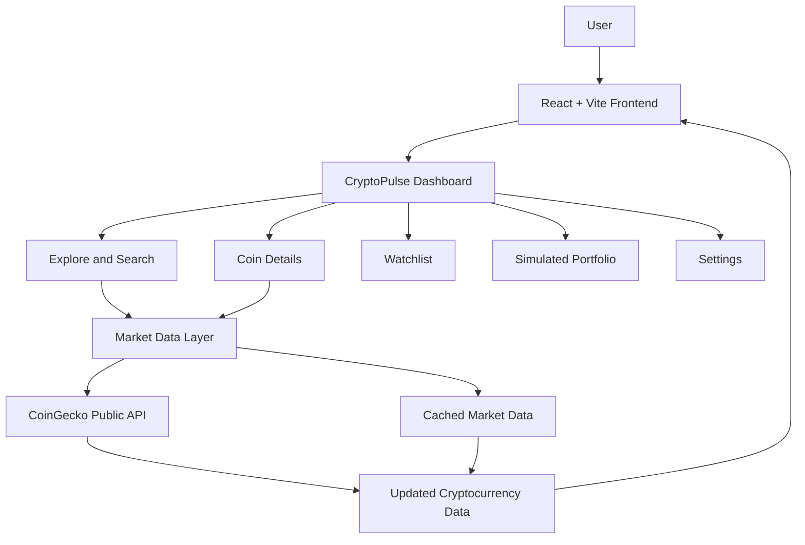

# CryptoPulse by arjuniverse

**See the Market. Feel the Pulse.**

CryptoPulse is a modern, responsive cryptocurrency tracking dashboard built with **React and Vite**. It uses live market data from the public CoinGecko API and provides tools to explore cryptocurrencies, monitor prices, manage a watchlist, and simulate a personal portfolio.

## Features

- **Dashboard:** View cryptocurrency market data and key statistics.
- **Explore:** Search, filter, and sort cryptocurrencies by name, symbol, price, and market capitalization.
- **Coin Details:** Explore individual cryptocurrency information.
- **Watchlist:** Add and remove favorite cryptocurrencies.
- **Portfolio:** Track a simulated cryptocurrency portfolio.
- **Settings:** Customize the theme, currency (USD/INR), and refresh interval.
- **Responsive UI:** Optimized for desktop, tablet, and mobile devices.

## Tech Stack

| Technology | Purpose |
|---|---|
| React | UI and component architecture |
| Vite | Development server and build tooling |
| JavaScript (ES6+) | Application logic |
| CSS | Styling and responsive layouts |
| CoinGecko API | Cryptocurrency market data |

## System Architecture



## Getting Started

### Prerequisites

- Node.js
- npm
- Git

### Installation

Clone the repository:

```bash
git clone https://github.com/arjuniverse/CryptoPulse.git
cd CryptoPulse
```

Install dependencies:

```bash
npm install
```

### Run Development Server

```bash
npm run dev
```

### Build for Production

```bash
npm run build
```

### Preview Production Build

```bash
npm run preview
```

## API and Data Handling

CryptoPulse retrieves cryptocurrency market information through the public **CoinGecko API**.

- API requests may be rate limited.
- Responses are cached to reduce repeated requests.
- Previously saved data can be displayed when the API is temporarily unavailable, with an appropriate notice.

## Important Note

The portfolio feature is simulated and intended for demonstration and educational purposes. CryptoPulse does not execute real trades or provide financial advice.

## Future Improvements

- Interactive cryptocurrency price charts
- Real-time market notifications
- Advanced portfolio analytics
- Price alerts
- Additional market indicators

## License

This project is available for personal and educational use. Add an appropriate open-source license if required.

## Author

**Arjun Sharma (arjuniverse)**

- GitHub: https://github.com/arjuniverse
- Repository: https://github.com/arjuniverse/CryptoPulse